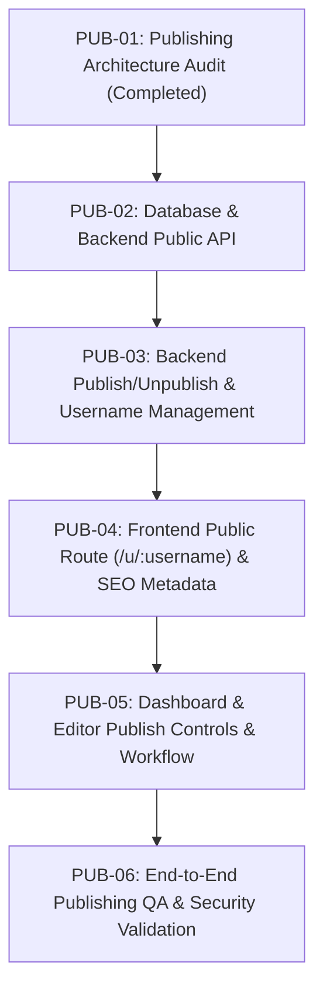

# FolioCraft – Phase 10: PUB-01 Publishing Architecture Audit Report

**Document ID:** `docs/phase-10/PUB-01-Publishing-Architecture-Audit.md`  
**Phase:** Phase 10 — Publishing  
**Task:** PUB-01: Publishing Architecture Audit  
**Status:** AUDIT COMPLETED – Architecture fully inspected  
**Target Branch:** `feat/publishing`  
**Date:** 2026-11-18  

---

## Executive Summary

This document presents the comprehensive architectural, database, backend, frontend, template rendering, and security audit for **Phase 10: Publishing** in the FolioCraft CV-to-Portfolio Builder platform. 

The audit established that while the foundational database columns (`username`, `template`, `published`) and template rendering systems (`TemplateMinimal`, `TemplateModern`, `TemplateProfessional`, `TemplateRenderer`, `PortfolioViewData`) are established from earlier phases, **no public publishing infrastructure currently exists**. Unauthenticated visitors cannot access portfolios, no public API route (`/api/portfolios/public/:username`) exists, no public Next.js page (`/u/:username`) is implemented, and no dedicated publish/unpublish controls are exposed in the Dashboard or Portfolio Editor.

All findings are backed by empirical inspection of source code, schemas, and test suites.

---

## Section 1 – Git Safety Report

Prior to code inspection or creating the target branch, a strict Git safety audit was executed.

### 1.1 Pre-Audit Working Tree & Branch Verification

The initial execution of Git status and inspection commands yielded the following state:

```bash
$ git branch --show-current
feat/live-preview

$ git status
On branch feat/live-preview
nothing to commit, working tree clean

$ git diff --stat
# (clean, 0 modified files)

$ git ls-files --others --exclude-standard
# (clean, 0 untracked files)
```

### 1.2 Status of the Nine Phase 9 Modifications

The user prompt noted that Phase 9 (Live Preview) final QA identified 9 modified uncommitted files on `feat/live-preview`.
Inspection of the commit history revealed that these 9 modifications were committed in commit `873e2a0` by Banula Peiris:

```
commit 873e2a0226107d526d6dc3e8f6509f9826ead360
Author: Banula Peiris <banulapeiris1uni@gmail.com>
Date:   Wed Nov 18 00:24:48 2026 +0530

    feat(preview): complete phase 9 live preview experience

 frontend/src/app/portfolio/templates/[templateId]/page.tsx   |  7 ++-----
 frontend/src/app/portfolio/templates/page.tsx               | 17 +++++++++--------
 frontend/src/components/portfolio/TemplateGallery.test.ts    |  1 +
 frontend/src/components/portfolio/TemplateSelector.test.ts   |  4 +++-
 frontend/src/templates/minimal/TemplateMinimal.tsx          |  2 +-
 frontend/src/templates/modern/TemplateModern.tsx            |  2 +-
 frontend/src/templates/professional/TemplateProfessional.tsx |  2 +-
 frontend/src/templates/responsiveAccessibility.test.ts      |  1 +
 frontend/src/templates/templateFoundation.test.ts           |  1 -
 9 files changed, 19 insertions(+), 18 deletions(-)
```

Furthermore, GitHub Pull Request #13 merged `feat/live-preview` (including commit `873e2a0`) into `origin/dev` at commit `cb80821`.

### 1.3 Remote Synchronization & Branch Creation

1. `git fetch origin` was executed. Remote tracking branch `origin/dev` was updated to `cb80821`.
2. Local `dev` was verified as an ancestor of `origin/dev` (`git merge-base --is-ancestor dev origin/dev` returned `True`).
3. Local `dev` was fast-forwarded to `origin/dev` (`cb80821`).
4. The target branch `feat/publishing` was created directly from the updated `dev` branch:
   ```bash
   git branch -f dev origin/dev
   git checkout -b feat/publishing dev
   ```
5. Verification of the active branch:
   - Current branch: `feat/publishing`
   - Head commit: `cb80821 Merge pull request #13 from banulapeiris1/feat/live-preview`
   - Working tree: Completely clean.
   - Preserved all Phase 9 modifications.

---

## Section 2 – Database Architecture

The FolioCraft database utilizes PostgreSQL. The core migration file is [schema.sql](file:///d:/D/university/Projects/FolioCraft/FolioCraft/backend/src/db/schema.sql) and is executed via [migrate.ts](file:///d:/D/university/Projects/FolioCraft/FolioCraft/backend/src/db/migrate.ts).

### 2.1 Existing Tables & Relevant Columns

#### 1. `users` Table ([schema.sql#L8-L15](file:///d:/D/university/Projects/FolioCraft/FolioCraft/backend/src/db/schema.sql#L8-L15))
- `id` UUID PRIMARY KEY DEFAULT `gen_random_uuid()`
- `name` VARCHAR(255) NOT NULL
- `email` VARCHAR(255) UNIQUE NOT NULL
- `password_hash` VARCHAR(255) NOT NULL
- `created_at` TIMESTAMPTZ DEFAULT CURRENT_TIMESTAMP
- `updated_at` TIMESTAMPTZ DEFAULT CURRENT_TIMESTAMP

#### 2. `portfolios` Table ([schema.sql#L22-L38](file:///d:/D/university/Projects/FolioCraft/FolioCraft/backend/src/db/schema.sql#L22-L38))
- `id` UUID PRIMARY KEY DEFAULT `gen_random_uuid()`
- `user_id` UUID NOT NULL REFERENCES `users(id)` ON DELETE CASCADE
- `name` VARCHAR(255) NOT NULL
- `email` VARCHAR(255)
- `phone` VARCHAR(50)
- `location` VARCHAR(255)
- `title` VARCHAR(255) NOT NULL
- `about` TEXT
- `profile_image_url` TEXT
- `social_links` JSONB DEFAULT `'{}'::jsonb`
- `username` VARCHAR(255) NOT NULL UNIQUE
- `template` VARCHAR(100) DEFAULT `'modern'`
- `published` BOOLEAN DEFAULT `false`
- `created_at` TIMESTAMPTZ DEFAULT CURRENT_TIMESTAMP
- `updated_at` TIMESTAMPTZ DEFAULT CURRENT_TIMESTAMP

#### 3. `projects` Table ([schema.sql#L64-L76](file:///d:/D/university/Projects/FolioCraft/FolioCraft/backend/src/db/schema.sql#L64-L76))
- `id` UUID PRIMARY KEY DEFAULT `gen_random_uuid()`
- `portfolio_id` UUID NOT NULL REFERENCES `portfolios(id)` ON DELETE CASCADE
- `title` VARCHAR(255) NOT NULL
- `description` TEXT
- `technologies` JSONB DEFAULT `'[]'::jsonb`
- `github_url` TEXT
- `project_url` TEXT
- `image_url` TEXT
- `order_index` INT NOT NULL DEFAULT 0
- `created_at` TIMESTAMPTZ
- `updated_at` TIMESTAMPTZ

#### 4. `skills` Table ([schema.sql#L83-L91](file:///d:/D/university/Projects/FolioCraft/FolioCraft/backend/src/db/schema.sql#L83-L91))
- `id` UUID PRIMARY KEY DEFAULT `gen_random_uuid()`
- `portfolio_id` UUID NOT NULL REFERENCES `portfolios(id)` ON DELETE CASCADE
- `name` VARCHAR(100) NOT NULL
- `category` VARCHAR(50) NOT NULL
- `order_index` INT NOT NULL DEFAULT 0
- `created_at` TIMESTAMPTZ
- `updated_at` TIMESTAMPTZ

#### 5. `experience` Table ([schema.sql#L146-L157](file:///d:/D/university/Projects/FolioCraft/FolioCraft/backend/src/db/schema.sql#L146-L157))
- `id` UUID PRIMARY KEY DEFAULT `gen_random_uuid()`
- `portfolio_id` UUID NOT NULL REFERENCES `portfolios(id)` ON DELETE CASCADE
- `company` VARCHAR(255) NOT NULL
- `position` VARCHAR(255) NOT NULL
- `description` TEXT
- `start_date` DATE NOT NULL
- `end_date` DATE
- `is_current` BOOLEAN NOT NULL DEFAULT false
- `created_at` TIMESTAMPTZ
- `updated_at` TIMESTAMPTZ

#### 6. `education` Table
- **Status: NOT PRESENT IN ACTIVE SCHEMA.**
- Empirical check shows `feat/education` was never merged to `dev`. There is no `education` table in `schema.sql` or active migrations.

### 2.2 Database Inspection Checklist Answers

1. **Does the portfolio table contain a username field?**  
   **YES.** Defined at [schema.sql#L33](file:///d:/D/university/Projects/FolioCraft/FolioCraft/backend/src/db/schema.sql#L33): `username VARCHAR(255) NOT NULL UNIQUE`.
2. **Is username unique?**  
   **YES.** Enforced by table constraint `portfolios_username_key UNIQUE (username)`. Verified in test suite [portfolio.schema.test.ts#L165-L178](file:///d:/D/university/Projects/FolioCraft/FolioCraft/backend/src/db/portfolio.schema.test.ts#L165-L178).
3. **Is username validation implemented?**  
   **PARTIALLY.** Validated via Zod (`/^[a-zA-Z0-9_-]+$/`, min 1, max 50) and normalized to lowercase in `portfolio.service.ts` ([portfolio.service.ts#L97](file:///d:/D/university/Projects/FolioCraft/FolioCraft/backend/src/services/portfolio.service.ts#L97)). However, the database unique constraint itself is case-sensitive `VARCHAR`, which presents a case-collision risk if case-normalization is ever bypassed.
4. **Does published/unpublished status exist?**  
   **YES.** Defined at [schema.sql#L35](file:///d:/D/university/Projects/FolioCraft/FolioCraft/backend/src/db/schema.sql#L35): `published BOOLEAN DEFAULT false`.
5. **Is there a public URL field?**  
   **NO.** There is no `public_url` column. The public URL is a computed route (`/u/:username`) derived dynamically from the `username` field.
6. **Are database constraints correctly defined?**  
   **YES.** Primary keys (UUIDs with `gen_random_uuid()`), Foreign keys (`user_id REFERENCES users(id)` and `portfolio_id REFERENCES portfolios(id)` both with `ON DELETE CASCADE`), and unique constraints are defined.
7. **Are foreign key relationships correct?**  
   **YES.** Deleting a user cascades to portfolios; deleting a portfolio cascades to projects, skills, and experience.
8. **Can the current schema support public portfolio access?**  
   **PARTIALLY.** The data exists, but query performance and case safety require enhancements:
   - Missing case-insensitive index on `LOWER(username)`.
   - Missing composite index on `(LOWER(username), published)` for high-concurrency public queries.
   - Missing `published_at` timestamp.
9. **Are there existing migrations that affect publishing?**  
   **NO.** Only the base definitions in `schema.sql` exist.

---

## Section 3 – Backend Architecture

The backend is built with Express, Node.js, and TypeScript ([server.ts](file:///d:/D/university/Projects/FolioCraft/FolioCraft/backend/src/server.ts)).

### 3.1 Existing Endpoints

All portfolio routes are defined in [portfolio.routes.ts](file:///d:/D/university/Projects/FolioCraft/FolioCraft/backend/src/routes/portfolio.routes.ts) and mounted at `/api/portfolios`:

| Method | Endpoint | Auth Required | Controller Action | Purpose |
|---|---|---|---|---|
| `GET` | `/api/portfolios` | **Yes** (`authMiddleware`) | `portfolioController.getPortfolios` | List all portfolios owned by authenticated user |
| `POST` | `/api/portfolios` | **Yes** (`authMiddleware`) | `portfolioController.createPortfolio` | Create a new portfolio |
| `GET` | `/api/portfolios/:id` | **Yes** (`authMiddleware`) | `portfolioController.getPortfolioById` | Get single portfolio by ID (ownership checked) |
| `PUT` | `/api/portfolios/:id` | **Yes** (`authMiddleware`) | `portfolioController.updatePortfolio` | Update portfolio fields (including `published`) |
| `DELETE` | `/api/portfolios/:id` | **Yes** (`authMiddleware`) | `portfolioController.deletePortfolio` | Delete portfolio by ID (ownership checked) |
| `POST` | `/api/portfolios/:id/projects` | **Yes** (`authMiddleware`) | `projectController.createProject` | Create project under portfolio |
| `GET` | `/api/portfolios/:id/projects` | **Yes** (`authMiddleware`) | `projectController.getProjectsByPortfolio` | List projects under portfolio |
| `POST` | `/api/portfolios/:id/skills` | **Yes** (`authMiddleware`) | `skillController.createSkill` | Create skill under portfolio |
| `GET` | `/api/portfolios/:id/skills` | **Yes** (`authMiddleware`) | `skillController.getSkills` | List skills under portfolio |
| `POST` | `/api/portfolios/:id/experience` | **Yes** (`authMiddleware`) | `experienceController.createExperience` | Create experience under portfolio |
| `GET` | `/api/portfolios/:id/experience` | **Yes** (`authMiddleware`) | `experienceController.getExperiencesByPortfolio` | List experiences under portfolio |

### 3.2 Authentication & Ownership Verification

- **Authentication Mechanism:** Handled by [auth.middleware.ts](file:///d:/D/university/Projects/FolioCraft/FolioCraft/backend/src/middleware/auth.middleware.ts). Inspects `Authorization: Bearer <token>`, verifies JWT against `JWT_SECRET`, and injects verified `req.user = { userId, email }`.
- **Ownership Verification:** Enforced in service layer methods:
  - [portfolio.service.ts#L198-L200](file:///d:/D/university/Projects/FolioCraft/FolioCraft/backend/src/services/portfolio.service.ts#L198-L200): `if (userId && row.user_id !== userId) throw new AppError("Unauthorized access to portfolio", 403);`
  - [portfolio.service.ts#L235-L237](file:///d:/D/university/Projects/FolioCraft/FolioCraft/backend/src/services/portfolio.service.ts#L235-L237): `if (existing.user_id !== userId) throw new AppError("Unauthorized to modify this portfolio", 403);`
  - [portfolio.service.ts#L367-L369](file:///d:/D/university/Projects/FolioCraft/FolioCraft/backend/src/services/portfolio.service.ts#L367-L369): `if (existing.user_id !== userId) throw new AppError("Unauthorized to delete this portfolio", 403);`

### 3.3 Missing Endpoints & Architectural Gaps

1. **NO Public Portfolio Endpoint:**  
   There is no endpoint such as `GET /api/portfolios/public/:username`.
2. **NO Dedicated Publish/Unpublish Endpoints:**  
   Currently, changing publication state can only be done as a side-effect of `PUT /api/portfolios/:id` with `{ published: true }`. There are no dedicated endpoints like `POST /api/portfolios/:id/publish` or `POST /api/portfolios/:id/unpublish`.
3. **NO Publishing Pre-Validation:**  
   When setting `published: true` via `PUT /api/portfolios/:id`, the backend performs zero validation on whether the portfolio has required content (e.g. title, valid username, at least one project/skill).
4. **NO Username Availability Check Endpoint:**  
   There is no endpoint such as `GET /api/portfolios/check-username/:username` to allow asynchronous frontend validation before submission.
5. **Sensitive Information Exposure Risk:**  
   The current `mapRowToPortfolio` method ([portfolio.service.ts#L50-L68](file:///d:/D/university/Projects/FolioCraft/FolioCraft/backend/src/services/portfolio.service.ts#L50-L68)) exposes `userId: row.user_id`. Returning this entity in a public API would leak the user's private account ID.

---

## Section 4 – Frontend Architecture

The frontend is a Next.js (App Router), React, TypeScript, and Tailwind CSS application ([frontend/src](file:///d:/D/university/Projects/FolioCraft/FolioCraft/frontend/src)).

### 4.1 Existing Routes & Components

| Route | Page File | Guard | Key Components |
|---|---|---|---|
| `/dashboard` | [app/dashboard/page.tsx](file:///d:/D/university/Projects/FolioCraft/FolioCraft/frontend/src/app/dashboard/page.tsx) | Auth redirect to `/login` | `PortfolioCard`, `PortfolioCardSkeleton` |
| `/portfolio/create` | [app/portfolio/create/page.tsx](file:///d:/D/university/Projects/FolioCraft/FolioCraft/frontend/src/app/portfolio/create/page.tsx) | Auth redirect to `/login` | `PortfolioForm`, `TemplateSelector` |
| `/portfolio/edit/[id]` | [app/portfolio/edit/[id]/page.tsx](file:///d:/D/university/Projects/FolioCraft/FolioCraft/frontend/src/app/portfolio/edit/[id]/page.tsx) | Auth redirect to `/login` | `PortfolioForm`, `ProjectManager`, `SkillManager`, `ExperienceManager`, `CvUploadManager`, `PreviewShell` |
| `/portfolio/preview` | [app/portfolio/preview/page.tsx](file:///d:/D/university/Projects/FolioCraft/FolioCraft/frontend/src/app/portfolio/preview/page.tsx) | Auth redirect to `/login` | `PreviewShell`, `TemplateRenderer` |
| `/portfolio/templates` | [app/portfolio/templates/page.tsx](file:///d:/D/university/Projects/FolioCraft/FolioCraft/frontend/src/app/portfolio/templates/page.tsx) | Auth redirect to `/login` | `TemplateGallery`, `TemplateSelector` |
| `/portfolio/templates/[templateId]` | [app/portfolio/templates/[templateId]/page.tsx](file:///d:/D/university/Projects/FolioCraft/FolioCraft/frontend/src/app/portfolio/templates/[templateId]/page.tsx) | Auth redirect to `/login` | `PreviewShell`, `TemplateRenderer` |

### 4.2 Dashboard Functionality ([PortfolioCard.tsx](file:///d:/D/university/Projects/FolioCraft/FolioCraft/frontend/src/components/portfolio/PortfolioCard.tsx))
- **Status Indicator:** Displays a green "Published" badge if `portfolio.published === true` or amber "Draft" badge if `false` ([PortfolioCard.tsx#L57-L72](file:///d:/D/university/Projects/FolioCraft/FolioCraft/frontend/src/components/portfolio/PortfolioCard.tsx#L57-L72)).
- **Username Display:** Displays `@{portfolio.username}` ([PortfolioCard.tsx#L84-L86](file:///d:/D/university/Projects/FolioCraft/FolioCraft/frontend/src/components/portfolio/PortfolioCard.tsx#L84-L86)).
- **Actions Provided:**
  - `Edit` (`/portfolio/edit/[id]`)
  - `Preview` (`/portfolio/preview?id=[id]`)
- **Missing Dashboard Publishing UI:**
  - No "Publish" / "Unpublish" toggle button on `PortfolioCard`.
  - No "View Live" link pointing to `/u/:username`.
  - No "Copy Public Link" button or feedback toast.

### 4.3 Missing Publishing UI in Portfolio Editor
- In `frontend/src/app/portfolio/edit/[id]/page.tsx`, there is no header publish button, no status toggle switch, and no public URL preview banner.

---

## Section 5 – Template Architecture

The template system is organized in [frontend/src/templates](file:///d:/D/university/Projects/FolioCraft/FolioCraft/frontend/src/templates).

### 5.1 Template Registry ([registry.ts](file:///d:/D/university/Projects/FolioCraft/FolioCraft/frontend/src/templates/registry.ts))

The system maintains a centralized registry of templates:

1. `modern` &rarr; `TemplateModern` ([TemplateModern.tsx](file:///d:/D/university/Projects/FolioCraft/FolioCraft/frontend/src/templates/modern/TemplateModern.tsx))
2. `minimal` &rarr; `TemplateMinimal` ([TemplateMinimal.tsx](file:///d:/D/university/Projects/FolioCraft/FolioCraft/frontend/src/templates/minimal/TemplateMinimal.tsx))
3. `professional` &rarr; `TemplateProfessional` ([TemplateProfessional.tsx](file:///d:/D/university/Projects/FolioCraft/FolioCraft/frontend/src/templates/professional/TemplateProfessional.tsx))

- **Registry Lookup & Fallback:** `getTemplateDefinition(templateId)` normalizes the template ID (trim, lowercase) and falls back to `DEFAULT_TEMPLATE_ID = "modern"` if the ID is missing or unregistered ([registry.ts#L64-L72](file:///d:/D/university/Projects/FolioCraft/FolioCraft/frontend/src/templates/registry.ts#L64-L72)).

### 5.2 Renderer Architecture ([TemplateRenderer.tsx](file:///d:/D/university/Projects/FolioCraft/FolioCraft/frontend/src/templates/TemplateRenderer.tsx))

`TemplateRenderer` accepts `{ templateId, data: PortfolioViewData, className }`. It resolves the template component dynamically from `TEMPLATE_REGISTRY` and renders it. It is strictly presentational, does not trigger API requests, and never mutates state.

### 5.3 Shared Data Structure ([types.ts](file:///d:/D/university/Projects/FolioCraft/FolioCraft/frontend/src/templates/types.ts))

All templates implement the `TemplateProps` contract: `{ data: PortfolioViewData, className?: string }`.

`PortfolioViewData` contains:
- **Profile:** `name`, `title`, `about`, `email`, `phone`, `location`, `profileImageUrl`, `socialLinks`, `username`
- **Collections:** `projects: Project[]`, `skills: Skill[]`, `experiences: Experience[]`
- **Theme:** `template: PortfolioTemplateId | string | null`

`PortfolioViewData` strictly adheres to the principle of separation of concerns:
- Excludes `userId` (preventing account exposure).
- Excludes database timestamps (`createdAt`, `updatedAt`).
- Excludes auth tokens and editor state.
- Excludes `education` (omitted from active codebase).

### 5.4 Public Rendering Compatibility

**Assessment: 100% COMPATIBLE.**
- The existing templates (`TemplateMinimal`, `TemplateModern`, `TemplateProfessional`) and `TemplateRenderer` are completely decoupled from authentication and editor hooks.
- As long as the public route (`/u/:username`) fetches and shapes the data into `PortfolioViewData`, `TemplateRenderer` can be reused directly without modifying the template components.

---

## Section 6 – Public Portfolio Access (`/u/:username`)

### 6.1 Route Existence & Status

- **Does `/u/:username` exist?**  
  **NO.** [frontend/src/app/u](file:///d:/D/university/Projects/FolioCraft/FolioCraft/frontend/src/app/u) does not exist.
- **Can anonymous visitors currently access portfolios?**  
  **NO.** Every existing page has an authentication guard that immediately redirects to `/login`.
- **Does a public portfolio API exist?**  
  **NO.** All backend `/api/portfolios/*` routes are protected by `authMiddleware`. Requests without a valid JWT receive `401 Unauthorized`.

### 6.2 Architectural Blueprint for Public Retrieval

```
[Anonymous Visitor / Recruiter]
             │
             │ GET /u/:username
             ▼
[Next.js App Router Page: /u/[username]/page.tsx]
             │
             │ GET /api/portfolios/public/:username (No Auth Header)
             ▼
[Backend: Public Portfolio Controller]
             │
             ├── 1. Validate & sanitize username param
             ├── 2. Query portfolios WHERE LOWER(username) = LOWER($1) AND published = true
             │      └── If not found OR published = false ──► Return 404 Not Found
             ├── 3. Batch query child projects, skills, experience
             ├── 4. Transform into sanitized PublicPortfolioDto (omit user_id, internal metadata)
             └── 5. Return 200 OK with portfolio JSON
             │
             ▼
[Next.js Page renders TemplateRenderer with PortfolioViewData]
```

### 6.3 Unpublished Portfolio Protection

To prevent attacker enumeration of private draft portfolios:
- If a portfolio exists with `published = false`, the public API **must return `404 Not Found`** with a generic message `"Portfolio not found"`.
- It **must NOT return `403 Forbidden`**, because returning 403 would confirm to attackers that the username exists in draft status.

---

## Section 7 – Security Assessment

A rigorous security review of the publishing flow identified the following risks, classified by severity:

| Risk ID | Severity | Area | Vulnerability Description & Evidence | Recommended Mitigation |
|---|---|---|---|---|
| **SEC-01** | **HIGH** | Database / Routing | **Case Sensitivity Collision in Username:** In `schema.sql`, `username VARCHAR(255) UNIQUE` is case-sensitive in PostgreSQL. While `portfolio.service.ts` normalizes usernames to lowercase during insert, direct DB operations or queries could create collisions between `"Alex"` and `"alex"`. On URL `/u/:username`, case mismatches can break routing. | Add a unique functional index: `CREATE UNIQUE INDEX idx_portfolios_username_lower ON portfolios (LOWER(username));` and case-insensitive lookup. |
| **SEC-02** | **HIGH** | API / Data Leakage | **Account UUID Leakage (`user_id`):** `portfolios.user_id` references `users.id`. In `portfolio.service.ts#mapRowToPortfolio`, `userId` is exposed. If raw entity rows are returned publicly, the user's permanent internal account ID is leaked. | Implement a strict `PublicPortfolioDto` serializer that strips `userId`, internal IDs, and audit timestamps. |
| **SEC-03** | **MEDIUM** | API / Enumeration | **Draft Portfolio Enumeration:** If the public API returns `403 Forbidden` for unpublished portfolios and `404 Not Found` for non-existent usernames, malicious actors can enumerate existing user handles. | Enforce identical `404 Not Found` responses (`{ message: "Portfolio not found" }`) for both non-existent and unpublished portfolios. |
| **SEC-04** | **MEDIUM** | State Integrity | **Publishing Incomplete / Invalid Portfolios:** Currently, `published` can be set to `true` via `PUT /api/portfolios/:id` without validating whether the portfolio contains required sections or basic content. | Implement a dedicated `POST /api/portfolios/:id/publish` endpoint that enforces pre-publication completeness checks. |
| **SEC-05** | **MEDIUM** | Routing / Spoofing | **Reserved Username Blacklist Absence:** Zod regex `/^[a-zA-Z0-9_-]+$/` permits usernames like `admin`, `api`, `login`, `u`, `dashboard`, `portfolio`, `system`. While portfolios reside under `/u/`, reserved words can cause confusion or future routing collisions. | Implement a reserved word blacklist in username validation. |
| **SEC-06** | **LOW** | PII / Scraping | **Public Contact Scraping (Email & Phone):** Public portfolios render raw `email` and `phone` strings if present. Automated web scrapers can harvest these for phishing or spam. | Allow users to toggle email/phone visibility in portfolio settings, or use client-side obfuscation. |
| **SEC-07** | **LOW** | DoS / Abuse | **Public Endpoint Flooding:** Public endpoints are unauthenticated and could be subjected to request flooding or scraping without rate limits. | Apply an IP-based rate limiter (e.g. `express-rate-limit`) on `/api/portfolios/public/*`. |

---

## Section 8 – Implementation Gaps

| Capability | Status | Evidence / Notes |
|---|---|---|
| **Database `username` field** | **ALREADY IMPLEMENTED** | Defined in [schema.sql#L33](file:///d:/D/university/Projects/FolioCraft/FolioCraft/backend/src/db/schema.sql#L33) with UNIQUE constraint. |
| **Database `published` field** | **ALREADY IMPLEMENTED** | Defined in [schema.sql#L35](file:///d:/D/university/Projects/FolioCraft/FolioCraft/backend/src/db/schema.sql#L35) (`BOOLEAN DEFAULT false`). |
| **Database `template` field** | **ALREADY IMPLEMENTED** | Defined in [schema.sql#L34](file:///d:/D/university/Projects/FolioCraft/FolioCraft/backend/src/db/schema.sql#L34) (`VARCHAR(100) DEFAULT 'modern'`). |
| **Database `published_at` timestamp** | **NOT IMPLEMENTED** | Not present in schema. |
| **Database Case-Insensitive Username Index** | **NOT IMPLEMENTED** | Current index is default case-sensitive B-tree. |
| **Database Public Lookup Composite Index** | **NOT IMPLEMENTED** | No index on `(LOWER(username), published)`. |
| **Database `education` table** | **NOT IMPLEMENTED** | Branch `feat/education` was never merged to `dev`. |
| **Authenticated Portfolio CRUD APIs** | **ALREADY IMPLEMENTED** | Full CRUD in `portfolio.controller.ts` & `portfolio.routes.ts`. |
| **Ownership Verification in Backend** | **ALREADY IMPLEMENTED** | Verifies `req.user.userId` against `row.user_id`. |
| **Dedicated Publish API (`/publish`)** | **NOT IMPLEMENTED** | Currently only generic `PUT /api/portfolios/:id` exists. |
| **Dedicated Unpublish API (`/unpublish`)** | **NOT IMPLEMENTED** | Currently only generic `PUT /api/portfolios/:id` exists. |
| **Public Portfolio API (`/public/:username`)** | **NOT IMPLEMENTED** | No unauthenticated retrieval endpoint exists. |
| **Username Availability Check API** | **NOT IMPLEMENTED** | No check endpoint exists. |
| **Public Portfolio Route (`/u/:username`)** | **NOT IMPLEMENTED** | Directory `frontend/src/app/u` does not exist. |
| **Template Registry & Resolver** | **ALREADY IMPLEMENTED** | `registry.ts` with `modern`, `minimal`, `professional`. |
| **Template Renderer Engine** | **ALREADY IMPLEMENTED** | `TemplateRenderer.tsx` with dynamic fallback. |
| **Shared Presentation Model (`PortfolioViewData`)** | **ALREADY IMPLEMENTED** | `types.ts` strips `userId` and internal metadata. |
| **Dashboard Status Badge (Draft/Published)** | **ALREADY IMPLEMENTED** | `PortfolioCard.tsx` renders emerald/amber badges. |
| **Dashboard Publish / Unpublish Action** | **NOT IMPLEMENTED** | No publish button on card or dashboard. |
| **Dashboard "View Live" & "Copy Link"** | **NOT IMPLEMENTED** | No public URL action on card. |
| **Editor Header Publish Controls** | **NOT IMPLEMENTED** | No publish button in editor header or settings. |
| **Public Portfolio 404 / Unpublished Screen** | **NOT IMPLEMENTED** | No branded visitor 404 page for unpublished portfolios. |

---

## Section 9 – Required Database Changes

> [!NOTE]  
> These changes are architectural recommendations for implementation in Phase 10 (PUB-02 onwards). No migrations were created during this audit.

### 9.1 Schema Additions & Indexes

```sql
-- 1. Ensure Case-Insensitive Uniqueness on Portfolios Username
CREATE UNIQUE INDEX IF NOT EXISTS idx_portfolios_username_lower
ON portfolios (LOWER(username));

-- 2. Add Composite Index for Fast Public Portfolio Retrieval
CREATE INDEX IF NOT EXISTS idx_portfolios_public_lookup
ON portfolios (LOWER(username), published);

-- 3. Add publication timestamp to track when portfolio went live
ALTER TABLE portfolios
ADD COLUMN IF NOT EXISTS published_at TIMESTAMP WITH TIME ZONE;
```

---

## Section 10 – Proposed Backend APIs

### 10.1 Public Portfolio Retrieval Endpoint
- **Method:** `GET`
- **Path:** `/api/portfolios/public/:username`
- **Authentication:** None (Public / Anonymous)
- **Rate Limit:** 60 requests/minute per IP
- **Success Response (200 OK):**
  ```json
  {
    "success": true,
    "portfolio": {
      "name": "Alex Chen",
      "title": "Senior Cloud Engineer",
      "about": "Passionate about cloud architecture.",
      "email": "alex@example.com",
      "phone": "+1 555-0199",
      "location": "San Francisco, CA",
      "profileImageUrl": "https://example.com/photo.jpg",
      "socialLinks": {
        "github": "https://github.com/alexchen",
        "linkedin": "https://linkedin.com/in/alexchen"
      },
      "username": "alexchen",
      "template": "modern",
      "published": true,
      "publishedAt": "2026-11-18T12:00:00.000Z",
      "projects": [ ... ],
      "skills": [ ... ],
      "experiences": [ ... ]
    }
  }
  ```
- **Error Responses:**
  - `400 Bad Request`: Invalid username format (non-alphanumeric).
  - `404 Not Found`: Portfolio does not exist OR is unpublished (`{ "message": "Portfolio not found" }`).

### 10.2 Dedicated Publish Endpoint
- **Method:** `POST`
- **Path:** `/api/portfolios/:id/publish`
- **Authentication:** `Bearer <JWT>`
- **Authorization:** Authenticated user must own the portfolio (`row.user_id === req.user.userId`).
- **Validation Rules:**
  - `name`, `title`, and `username` must not be blank.
  - `username` must conform to regex `/^[a-zA-Z0-9_-]+$/` and not be in reserved word list.
- **Success Response (200 OK):**
  ```json
  {
    "success": true,
    "message": "Portfolio published successfully",
    "portfolio": {
      "id": "3fa85f64-5717-4562-b3fc-2c963f66afa6",
      "username": "alexchen",
      "published": true,
      "publishedAt": "2026-11-18T12:00:00.000Z",
      "publicUrl": "/u/alexchen"
    }
  }
  ```

### 10.3 Dedicated Unpublish Endpoint
- **Method:** `POST`
- **Path:** `/api/portfolios/:id/unpublish`
- **Authentication:** `Bearer <JWT>`
- **Authorization:** Authenticated user must own the portfolio.
- **Success Response (200 OK):**
  ```json
  {
    "success": true,
    "message": "Portfolio unpublished successfully",
    "portfolio": {
      "id": "3fa85f64-5717-4562-b3fc-2c963f66afa6",
      "username": "alexchen",
      "published": false,
      "publishedAt": null
    }
  }
  ```

### 10.4 Username Availability Check Endpoint
- **Method:** `GET`
- **Path:** `/api/portfolios/check-username/:username`
- **Authentication:** Optional / Public or Authenticated
- **Query / Param:** `:username`
- **Success Response (200 OK):**
  ```json
  {
    "username": "alexchen",
    "available": false,
    "reason": "Username is already taken"
  }
  ```

---

## Section 11 – Proposed Frontend Components

1. **Public Portfolio Dynamic Route:**  
   `frontend/src/app/u/[username]/page.tsx`  
   - Handles public visitor traffic.
   - Fetches data from `GET /api/portfolios/public/:username`.
   - Generates dynamic SEO `<head>` metadata (Title, Open Graph tags, Twitter cards).
   - Renders `TemplateRenderer` with `PortfolioViewData`.
   - Displays clean, branded `PortfolioNotFound` state for 404s.
2. **Publish Action Modal / Drawer:**  
   `frontend/src/components/portfolio/PublishModal.tsx`  
   - Modal invoked when user clicks "Publish".
   - Shows pre-publish checklist (Basic info complete, valid handle, template selected).
   - Generates full public URL (`https://.../u/:username`).
   - Includes one-click "Copy Link" button with copied toast feedback.
3. **Enhanced Dashboard Portfolio Card:**  
   `frontend/src/components/portfolio/PortfolioCard.tsx`  
   - Add "Publish" / "Unpublish" direct quick action.
   - Add "View Live" external link button (enabled only when published).
   - Add "Copy Link" icon button with clipboard interaction.
4. **Enhanced Portfolio Editor Header:**  
   `frontend/src/app/portfolio/edit/[id]/page.tsx`  
   - Add global "Publish" / "Unpublish" button in top editor navigation bar alongside layout controls.

---

## Section 12 – Recommended PUB-02 Onward Sequence



### Detailed Breakdown:

1. **PUB-02: Database Indexing & Backend Public Retrieval API**
   - Implement database migration: `idx_portfolios_username_lower`, `idx_portfolios_public_lookup`, and `published_at`.
   - Implement `GET /api/portfolios/public/:username` with complete aggregation of projects, skills, and experience.
   - Implement strict DTO mapping omitting `userId` and internal account secrets.
   - Unit and integration tests for public retrieval, unpublished 404 protection, and case-insensitivity.

2. **PUB-03: Backend Publish, Unpublish & Username Availability**
   - Implement `POST /api/portfolios/:id/publish` with completeness validation.
   - Implement `POST /api/portfolios/:id/unpublish`.
   - Implement `GET /api/portfolios/check-username/:username` with reserved words blacklist.
   - Integration tests verifying ownership checks and status toggling.

3. **PUB-04: Frontend Public Portfolio Page (`/u/:username`)**
   - Create `src/app/u/[username]/page.tsx`.
   - Implement dynamic metadata generation (Open Graph, title, description).
   - Integrate `TemplateRenderer` with public data.
   - Implement custom 404 Not Found screen for missing/unpublished portfolios.
   - Component and integration tests for unauthenticated rendering.

4. **PUB-05: Dashboard & Editor Publishing Controls**
   - Create `PublishModal` with URL generation and clipboard copy.
   - Update `PortfolioCard.tsx` with Publish/Unpublish toggle, "View Live", and "Copy Link".
   - Update `EditPortfolioPage` header with Publish controls.
   - Client API integration in `api.ts`.

5. **PUB-06: End-to-End Publishing QA & Verification**
   - Verify complete user journey: Create &rarr; Edit &rarr; Preview &rarr; Publish &rarr; Visit `/u/:username` anonymously.
   - Verify unpublishing immediately makes `/u/:username` return 404.
   - Verify republishing restores access.
   - Verify security constraints (no private data leakage, no XSS, no enumeration).

---

## Section 13 – Final Audit Decision

**Status:** **AUDIT COMPLETED – Architecture fully inspected.**

The FolioCraft repository on branch `feat/publishing` has been thoroughly analyzed. The codebase is fully prepared for Phase 10 implementation following the recommended roadmap above. No modifications have been made to source code, database schemas, or dependencies during this audit.

