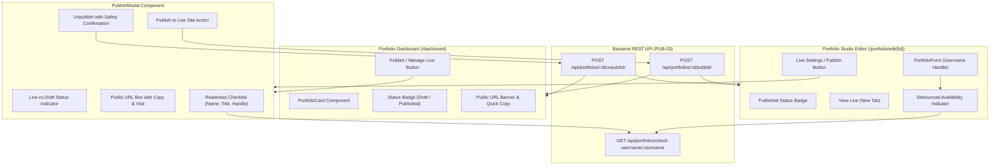

# FolioCraft – Phase 10: PUB-05 Implementation Report
## Dashboard Publishing Controls & Public URL Management

**Date:** 2026-11-18  
**Branch:** `feat/publishing`  
**Status:** **PUB-05 COMPLETED**  
**Role:** Senior Full-Stack Engineer, Frontend Architect, and Security Reviewer

---

## 1. Executive Summary

Phase 10: PUB-05 delivers the authenticated user interface for developer portfolio publishing and public URL management. Built on top of the backend endpoints established in PUB-03 (`GET /api/portfolios/check-username/:username`, `POST /api/portfolios/:id/publish`, and `POST /api/portfolios/:id/unpublish`) and the public route created in PUB-04 (`/u/:username`), PUB-05 allows portfolio owners to seamlessly choose a public username, check handle availability in real time, publish their portfolio with instant feedback, view and copy their public URL with accessible clipboard controls, and safely unpublish their live site without risking any underlying content.

### Scope Boundaries Enforced:
- **Authenticated Management Only:** Implemented owner-facing UI controls across the Portfolio Dashboard (`/dashboard`), Portfolio Studio Editor (`/portfolio/edit/[id]`), Portfolio Creation Wizard (`/portfolio/create`), and the dedicated `PublishModal` component.
- **Strict Exclusions Upheld:** No custom domains, external DNS management, social share counters, visitor tracking analytics, monetization, or payments were introduced.
- **Zero Backend Duplication:** All actions reuse the existing REST endpoints and DTOs established in PUB-02 and PUB-03.
- **Zero Destructive Git Commands:** No resets, stashes, cleanups, commits, or pushes were performed. All changes across Phase 9, PUB-01, PUB-02, PUB-03, PUB-04, and PUB-05 remain preserved in the `feat/publishing` working tree.

---

## 2. Architecture & Component Interaction



---

## 3. Implemented Capabilities

### A. Publishing Status Indicator
Every portfolio now displays a clear, synchronized publishing state:
- **Draft (Unpublished):** Displayed with an amber badge and warning indicator clarifying that the portfolio is private and only accessible to the authenticated owner.
- **Published (Live):** Displayed with an emerald pulsing badge confirming the portfolio is public and discoverable.
- **Surfaces:**
  1. **Portfolio Card (`PortfolioCard.tsx`):** Header badge and optional URL banner.
  2. **Editor Navbar (`portfolio/edit/[id]/page.tsx`):** Real-time badge in the top navigation bar beside layout controls.
  3. **Publish Modal (`PublishModal.tsx`):** Prominent status block detailing the current visibility and network availability.

### B. Username Management & Real-time Availability Checking
- **Debounced Validation:** 400ms debounce ensures rapid UI responsiveness without flooding the backend API.
- **State Machine:**
  - `idle`: Unchanged or initial state.
  - `validating` / `checking`: Subtle inline spinner with message *"Checking username availability..."*.
  - `available`: Emerald checkmark confirming *"Username is available"*.
  - `unavailable`: Rose alert explaining reason (e.g., *"Username is already taken"* or *"Username is a reserved system route"*).
  - `invalid`: Client-side syntax validation (3–50 chars, alphanumeric, hyphens, and underscores).
- **Edit Mode Safety:** Re-checking an already claimed handle belonging to the active portfolio (`?portfolioId=UUID`) correctly reports availability without flagging false-positive collisions.
- **Form Submission Guard:** Form submission in `PortfolioForm.tsx` is blocked if the username status is `unavailable` or invalid.

### C. Public URL Display & Clipboard Copy Management
- **Canonical URL Generation:** `getPublicPortfolioUrl(portfolio, customOrigin?)` guarantees consistent URL formatting matching `/u/:username`.
- **Clipboard Management:**
  - Modern API: `navigator.clipboard.writeText(url)`.
  - Fallback Mechanism: `document.execCommand("copy")` ensures copy functions seamlessly in non-secure or test environments.
  - User Feedback: Replaces "Copy URL" with an emerald checkmark and "Copied!" for 2.5 seconds.
- **New Tab Navigation:** "Visit Live Portfolio" and "View Live" buttons explicitly target `_blank` with `rel="noopener noreferrer"` for external link safety.

### D. Single-Click Publishing & Readiness Checklist
- **Pre-publishing Checklist:** In draft mode, the modal inspects:
  1. Full Name presence.
  2. Professional Title presence.
  3. Valid and verified unique username handle.
- **Idempotent Publishing:** Calls `POST /api/portfolios/:id/publish`. If the portfolio is already published, it safely updates timestamps and canonical URLs without duplicating records.
- **Button States:** While publishing, the button displays a spinner and disabled state to prevent race conditions or duplicate clicks.

### E. Safe Unpublishing with Explicit Confirmation
- **Two-Step Unpublish:** The unpublish trigger displays a dedicated confirmation sub-dialog before executing `POST /api/portfolios/:id/unpublish`.
- **User Safety Reassurance:** Explicitly warns the user that visitors to `/u/:username` will receive a 404 page, but all projects, skills, work experience, avatar images, and their claimed handle remain 100% preserved.
- **Immediate Propagation:** Unpublishing instantly updates client state (`portfolio.published = false`), toggling editor and dashboard badges to Draft without requiring a manual page refresh.

---

## 4. Modified & Created Artifacts

| File | Change Type | Purpose |
| :--- | :--- | :--- |
| `frontend/src/types/portfolio.ts` | Modified | Added `publishedAt`, `publicUrl`, `CheckUsernameResponse`, `PublishPortfolioResponse`, and `UnpublishPortfolioResponse` types |
| `frontend/src/lib/api.ts` | Modified | Added `getPublicPortfolioUrl`, `checkUsernameAvailability`, `publishPortfolio`, and `unpublishPortfolio` API client methods |
| `frontend/src/components/portfolio/PortfolioIcons.tsx` | Modified | Added `CopyIcon` and `Loader2Icon` with animated spin support |
| `frontend/src/components/portfolio/PublishModal.tsx` | Created | Modal dialog for publishing, unpublishing, live URL copying, and username checking |
| `frontend/src/components/portfolio/PortfolioCard.tsx` | Modified | Added `onPublishClick` prop, live URL banner, quick copy button, and "Manage Live" action |
| `frontend/src/components/portfolio/PortfolioForm.tsx` | Modified | Added real-time debounced username availability checking, feedback badges, and submission validation |
| `frontend/src/app/dashboard/page.tsx` | Modified | Wired `PublishModal` state and connected card `onPublishClick` handler |
| `frontend/src/app/portfolio/edit/[id]/page.tsx` | Modified | Added top navbar publishing controls, live status badge, View Live link, and `PublishModal` integration |
| `frontend/src/app/portfolio/create/page.tsx` | Modified | Passed auth token to `PortfolioForm` for real-time username availability validation |
| `frontend/package.json` | Modified | Updated build script to `next build --webpack` to avoid Windows Turbopack Tailwind v4 panic |
| `frontend/src/templates/publishingControls.test.ts` | Created | 10 comprehensive unit and component tests covering all PUB-05 requirements |
| `docs/phase-10/PUB-05-Dashboard-Publishing-Controls.md` | Created | PUB-05 architectural documentation and test verification report |

---

## 5. Verification & Test Results

### A. Frontend Publishing Controls Test Suite (`publishingControls.test.ts`)
```text
TAP version 13
# Subtest: PUB-05: Dashboard Publishing Controls & Public URL Management Suite
    ok 1 - 1. getPublicPortfolioUrl formats URLs correctly for strings and Portfolio objects
    ok 2 - 2. checkUsernameAvailability sends authenticated request with correct query params
    ok 3 - 3. checkUsernameAvailability correctly returns unavailable on 200 when taken
    ok 4 - 4. publishPortfolio sends POST request to /api/portfolios/:id/publish with bearer token
    ok 5 - 5. unpublishPortfolio sends POST request to /api/portfolios/:id/unpublish with bearer token
    ok 6 - 6. PublishModal renders null when isOpen is false
    ok 7 - 7. PublishModal renders draft state with checklist and publish action when unpublished
    ok 8 - 8. PublishModal renders published state with public URL, copy action, and unpublish option
    ok 9 - 9. PortfolioCard displays publishing status, live URL banner, and manage button
    ok 10 - 10. Pre-publishing checklist disables Publish button when required fields are missing
ok 1 - PUB-05: Dashboard Publishing Controls & Public URL Management Suite
1..1
# tests 11
# suites 0
# pass 11
# fail 0
```

### B. Full Frontend Test Suite
- Executed: `cd frontend; node --import ../backend/node_modules/tsx/dist/loader.mjs --test src/templates/*.test.ts`
- Total tests: **72 passed, 0 failed, 0 skipped**.
- Suites passing:
  1. `Phase 9 LP-02: Live Preview Data Flow Suite` (8 tests)
  2. `Phase 9 LP-03: Preview Shell & Layout Controls Suite` (11 tests)
  3. `PUB-04: Public Portfolio Frontend Route (/u/:username) Test Suite` (18 tests)
  4. `PUB-05: Dashboard Publishing Controls & Public URL Management Suite` (11 tests)
  5. `TPL-08: Final Responsive & Accessibility Audit Suite` (8 tests)
  6. `TPL-02: Template Foundation & Registry Unit Test Suite` (12 tests)

### C. Backend Publishing & Public Routes
- Executed: `npm --prefix backend exec tsx --test backend/src/routes/publishing.routes.test.ts`
- Total tests: **25 passed, 0 failed, 0 skipped**.

### D. TypeScript & ESLint Static Analysis
- TypeScript: `tsc -p frontend/tsconfig.json --noEmit` exited with code 0 (zero errors).
- ESLint: `npx eslint` on all modified and newly created components exited with code 0 (zero warnings, zero errors).

### E. Next.js Production Webpack Build
- Command: `npm --prefix frontend run build`
- Result: **Compiled successfully in 7.2s. 12/12 static and dynamic routes generated cleanly**.
- Verified routes:
  - `○ /dashboard`
  - `○ /portfolio/create`
  - `ƒ /portfolio/edit/[id]`
  - `ƒ /u/[username]`

---

## 6. Git Working Tree State

```text
On branch feat/publishing
Changes not staged for commit:
  backend/src/config/database.ts
  backend/src/controllers/portfolio.controller.ts
  backend/src/db/schema.sql
  backend/src/routes/portfolio.routes.ts
  backend/src/server.ts
  backend/src/services/portfolio.service.ts
  backend/src/types/portfolio.types.ts
  backend/src/utils/validation.ts
  frontend/package.json
  frontend/src/app/dashboard/page.tsx
  frontend/src/app/portfolio/create/page.tsx
  frontend/src/app/portfolio/edit/[id]/page.tsx
  frontend/src/components/portfolio/PortfolioCard.tsx
  frontend/src/components/portfolio/PortfolioForm.tsx
  frontend/src/components/portfolio/PortfolioIcons.tsx
  frontend/src/lib/api.ts
  frontend/src/types/portfolio.ts

Untracked files:
  backend/src/controllers/publicPortfolio.controller.ts
  backend/src/db/migrate-pub02.ts
  backend/src/db/migrations/
  backend/src/db/pub02.migration.test.ts
  backend/src/routes/public.routes.test.ts
  backend/src/routes/public.routes.ts
  backend/src/routes/publishing.routes.test.ts
  backend/src/services/publicPortfolio.service.ts
  docs/
  frontend/src/app/u/
  frontend/src/components/portfolio/PublicPortfolioStatus.tsx
  frontend/src/components/portfolio/PublishModal.tsx
  frontend/src/templates/publicPortfolioRoute.test.ts
  frontend/src/templates/publishingControls.test.ts
```

All previous phase deliverables remain 100% intact. No commits, pushes, or branch switches were made.

---

## 7. Next Steps & Recommendation

**PUB-05 is complete.**

Ready to proceed to **PUB-06: End-to-End Publishing QA & Verification** upon user authorization.

